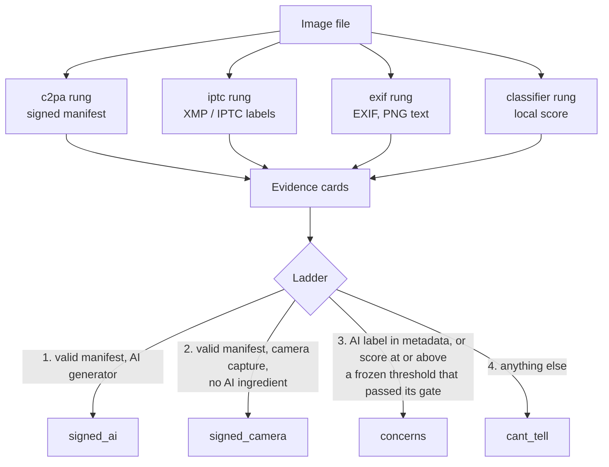

# Architecture

Status: in development, 28 Oct 2026. The contract below is `secondlook/types.py`, copied verbatim from the build plan (`PLAN.md`).

## The ladder and its rungs

Every available rung runs on the file. Each rung returns evidence cards, or an empty list when it finds nothing, and never raises on bad input. The ladder then decides from the evidence alone. The order of the rungs does not change the answer.

```
                         one image file
                               |
     +-----------+-------------+------------+--------------+
     |           |             |            |              |
 [c2pa rung] [iptc rung]  [exif rung]  [classifier rung]   (deferred rungs:
 signed       metadata     metadata     signal              watermark, origin)
 manifest     (XMP/IPTC)   (EXIF, PNG   local score,
 check                     text)        never a verdict
     |           |             |            |
     +-----------+------+------+------------+
                        |
                 list of Evidence cards
        (finding, proves, does_not_prove, strength, raw)
                        |
                    THE LADDER   (secondlook/ladder.py)
                        |
   1. valid C2PA manifest, AI generator ............ signed_ai
   2. valid C2PA manifest, camera capture,
      no AI ingredient ............................. signed_camera
   3. any AI label in unsigned metadata, or
      classifier score >= frozen threshold that
      passed its gate (classifier_gate.json) ....... concerns
   4. anything else ................................ cant_tell
                        |
        Result(answer, evidence, summary, version)
                        |
         +--------------+---------------+
         |                              |
   CLI: secondlook check <file>   Demo page (local, 127.0.0.1)
   prints JSON                    answer + one card per evidence
```

The ladder is read top to bottom and the first rule that matches wins. Rules 1 and 2 need a **signed** manifest. Rule 3 can only ever produce `concerns`.

### The same ladder as a diagram



## Rung strengths

Each card carries a `strength`. The columns below are the rung convention: the ladder's concern test (`ladder._is_concern`) reads the rung and `raw` (such as `above_threshold` with `raises_concern`, `ai_label`, `valid`), not `strength`, so `strength` is a label rungs set, not a rule the ladder enforces. Rules 1 and 2 read only a `signed` card from the c2pa rung whose manifest validated.

| Strength | Meaning | Can it set `signed_*`? | Can it set `concerns`? |
|---|---|---|---|
| `signed` | A signed C2PA manifest, whether or not it validated | Only when the manifest validated (c2pa rung only) | Yes, a manifest that fails validation is listed as a reason |
| `metadata` | A label or field in the file that anyone can write or strip | No | Yes, if it carries an AI label |
| `signal` | A statistical score from a model | No | Yes, only at or above a frozen threshold that passed its gate (`classifier_gate.json`); the v2 gate failed, so not today |
| `none` | Informational | No | No, by convention |

## The data contract

```python
Answer = Literal["signed_ai", "signed_camera", "concerns", "cant_tell"]

@dataclass
class Evidence:
    rung: Literal["c2pa", "iptc", "exif", "watermark", "classifier", "origin", "claim"]
    finding: str            # one plain sentence
    proves: str             # what this does establish
    does_not_prove: str     # its limit, always filled
    strength: Literal["signed", "metadata", "signal", "none"]
    raw: dict = field(default_factory=dict)   # machine detail (scores, claim generator, cert issuer)

@dataclass
class Result:
    answer: Answer
    evidence: list[Evidence]
    summary: str            # 1 to 2 sentences
    version: str            # git sha of secondlook
```

Each rung is a function `check(path: str) -> list[Evidence]` in `secondlook/rungs/<name>.py`.

## What each rung does

| Rung | Module | Reads | Tooling | Strength |
|---|---|---|---|---|
| C2PA | `rungs/c2pa.py` | Content Credentials manifest and its signature | `c2pa-python` | `signed` |
| IPTC / XMP | `rungs/iptc.py` | Digital source type and AI-system fields | Python standard library XML parser, Pillow for XMP in PNG | `metadata` |
| EXIF | `rungs/exif.py` | Software field and PNG generator text | Pillow | `metadata` |
| Classifier | `rungs/classifier.py` | Pixels | Community Forensics ViT-S/16 384, run locally on PyTorch (MPS where present) | `signal` |
| Claim receipts | `rungs/claim.py` | A typed claim, not an image | Offline Data Commons ClaimReview index (SQLite FTS5) | `none` |

The claim rung is separate from the image ladder. It takes typed text, returns `[]` from `check(path)`, and is called as `check_claim(text)`. It gives no true or false verdict of its own: it shows what a named fact-checker has already published about a similar claim, word for word, with date and link. The default answer is "No existing fact-check found."

**Not built:** the watermark rung (it only finds marks we embed ourselves) and the origin rung ("earliest copy found"). They are in the contract and in the plan, and neither has been built. Nothing in the demo or the answers relies on them.

## The gate path (how the classifier is measured)

```
 L4 test set  --->  split once (dev / test)  --->  classifier scored on dev only
 (open-licence       sha256 of each split          threshold frozen in advance,
  non-AI photos,     recorded                      file and sha256 committed
  CC0 AI images)                                              |
                                                              v
   RESULTS.md <---  gate harness  <---  predictions on test, 4 arms
   (observed rate    (one-sided 95%     original and format-matched (gated),
   and upper bound    exact bound)      compressed q70 and size-matched 512
   per arm, per topic,                  (reported); one command: gate_run
   shortcut labels)
```

The harness is the L2 gate harness, vendored unchanged into `gate/`. It uses only the Python standard library, opens no network connection and calls no model. It refuses a run if the split hashes differ from the ones frozen in the threshold file. `python -m secondlook.gate_run` (or `scripts/gate_run.sh`) runs the whole path as one command: it checks the L4 LOCK, SCREEN-CONFIG and ACCEPTED hashes, derives the arms from the originals, scores the test images, refuses unless `threshold.json` was committed first, runs the harness and the file-facts shortcut baseline, and writes `RESULTS.md`. See `docs/GATE-RUN.md`.

## Status by merge (main at `254999a`, 29 Oct 2026)

| Piece | Ticket | Merged into `main` as | State |
|---|---|---|---|
| Skeleton, contract, ladder, CLI | DAT-846 | `a0ae4e8`; hardening round `937fa7f` | On main. |
| Provenance rungs (C2PA, IPTC, EXIF) | DAT-847 | `b4c160d` (stage 1 and the fix round), `dddb5ce` (stage 3, the interim trust list) | On main. |
| Classifier rung and calibration | DAT-848 | `869d861` | On main. The threshold (0.4319957792758942) was frozen on the v2 dev split at `e4c8879` and its v2 gate is a FAIL ([RESULTS-v2.md](RESULTS-v2.md)), so the classifier card shows the score and raises no concern (`secondlook/rungs/classifier_gate.json`, PR #33 at `254999a`). |
| Test set (fetch and freeze) | DAT-849 | outside the repo | The frozen L4 set. The v2 gate ran on it (test 425 real, 293 AI); see [RESULTS.md](RESULTS.md). |
| Demo page | DAT-850 | `47f9fd1` (S5), then later merges | On main. Runs on the installed rungs; canned answers only behind `--stub`. |
| Claim receipts | DAT-851 | `dbcd49b` | On main. |
| Integration and gate run | DAT-852 | `6fbb5c7` (the one-command gate run, `secondlook/gate_run.py`; see [GATE-RUN.md](GATE-RUN.md)) | On main. The real run happened on 29 Oct 2026: v1 INVALID, v2 FAIL, held-out arm reported ([RESULTS.md](RESULTS.md)). |

This table lists the merge commit of each piece on `main` of the private build repository. This public repository is one snapshot commit made from that `main`, so those hashes are not in its history.
